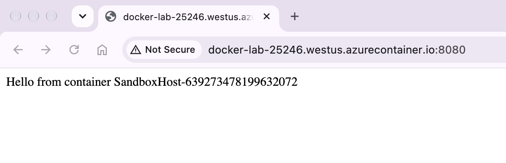
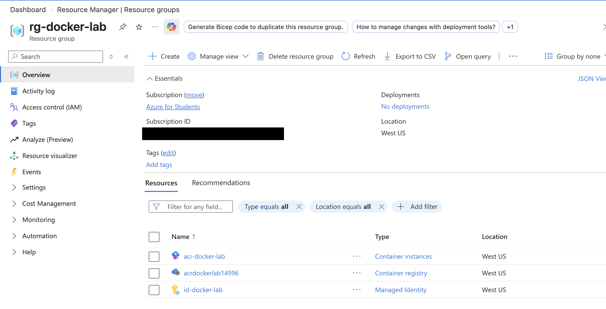
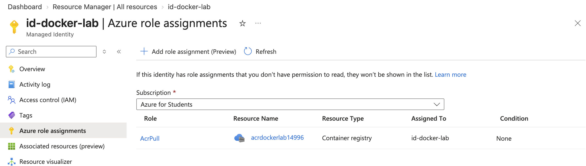
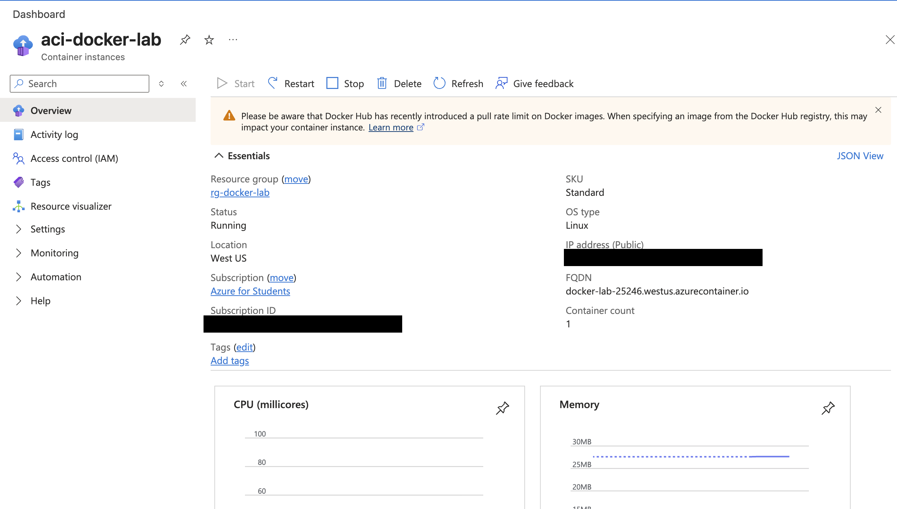
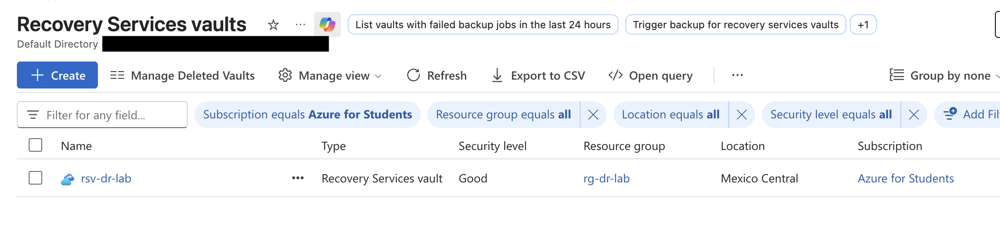
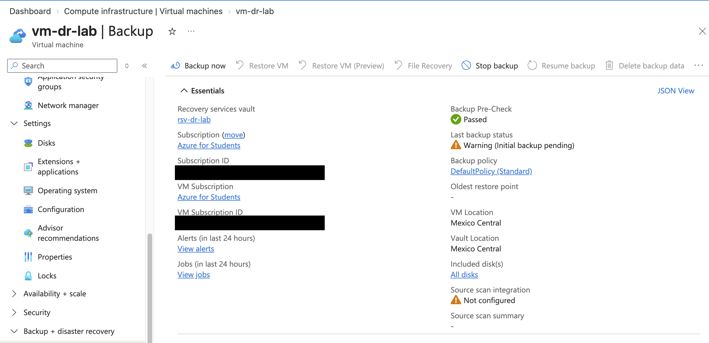
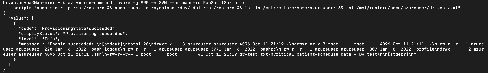
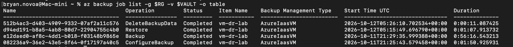
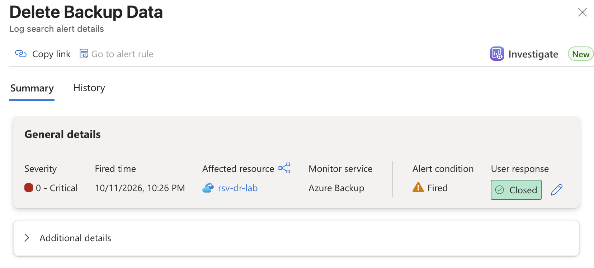
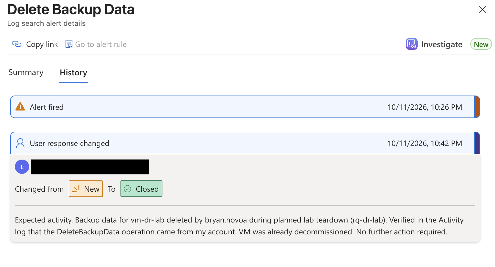

# Azure Container and Disaster Recovery Labs

Two hands-on Azure labs built from the command line with the Azure CLI and Docker:

1. **Container Lab:** containerized a Python app, pushed it to a private Azure Container Registry, and deployed it to Azure Container Instances using a least-privilege managed identity.
2. **Disaster Recovery Lab:** protected a Linux VM with Azure Backup, simulated data loss, restored the disk from a recovery point, and recovered the lost file without impacting the running system.

> These are personal lab projects built on an Azure for Students subscription. All resources were torn down after each lab to control cost.

**Skills demonstrated:** Docker, Azure Container Registry, Azure Container Instances, managed identities, Azure RBAC, Azure Backup, Recovery Services vaults, Linux administration, Bash scripting, Azure Policy troubleshooting

---

## Repository Structure

```
.
├── README.md
├── docker-lab/
│   ├── app.py
│   ├── requirements.txt
│   └── Dockerfile
└── screenshots/
    ├── docker/
    └── dr/
```

---

## Lab 1: Containerize and Deploy to Azure

### Architecture

```
Mac (Apple Silicon)                 Azure (West US)
-------------------                 --------------------------------------------
Dockerfile  --docker build-->       Azure Container Registry (private)
  (linux/amd64)  --docker push-->          |
                                           | AcrPull (scoped to this registry only)
                                           v
                                    User-assigned managed identity
                                           |
                                           v
                                    Azure Container Instances --> public FQDN :8080
```

### The App

A small Flask app that returns the hostname of the container serving the request, plus a `/health` endpoint.

```python
from flask import Flask
import socket

app = Flask(__name__)

@app.route("/")
def home():
    return f"Hello from container {socket.gethostname()}\n"

@app.route("/health")
def health():
    return "ok\n"

if __name__ == "__main__":
    app.run(host="0.0.0.0", port=8080)
```

### The Dockerfile

```dockerfile
FROM python:3.12-slim
WORKDIR /app
COPY requirements.txt .
RUN pip install --no-cache-dir -r requirements.txt
COPY app.py .
RUN useradd -m appuser
USER appuser
EXPOSE 8080
CMD ["python", "app.py"]
```

Design choices:

- **Slim base image** to reduce size and attack surface.
- **Dependencies copied before app code** so Docker reuses the cached dependency layer when only the code changes. Verified by rebuilding after a code change and confirming the `pip install` step showed `CACHED`.
- **Non-root user** (`appuser`). Verified inside the running container with `whoami`.

### Steps

**1. Build and test locally**

```bash
docker build -t docker-lab:v1 .
docker run -d -p 8080:8080 --name lab docker-lab:v1
docker logs lab
docker exec -it lab whoami     # returns appuser
```

**2. Create the registry and push the image**

```bash
RG=rg-docker-lab
LOC=westus
ACR=acrdockerlab$RANDOM

az group create --name $RG --location $LOC
az acr create --resource-group $RG --name $ACR --sku Basic

az acr login --name $ACR
docker build --platform linux/amd64 -t $ACR.azurecr.io/docker-lab:v1 .
docker push $ACR.azurecr.io/docker-lab:v1
```

The `--platform linux/amd64` flag matters: the image was built on an Apple Silicon (ARM) Mac, while Azure Container Instances runs amd64.

**3. Create a managed identity with pull-only access**

```bash
az identity create --resource-group $RG --name id-docker-lab
ID_ID=$(az identity show -g $RG -n id-docker-lab --query id -o tsv)
ID_PRINCIPAL=$(az identity show -g $RG -n id-docker-lab --query principalId -o tsv)
ACR_ID=$(az acr show --name $ACR --query id -o tsv)

az role assignment create --assignee-object-id $ID_PRINCIPAL \
  --assignee-principal-type ServicePrincipal \
  --role AcrPull --scope $ACR_ID
```

**4. Deploy to Azure Container Instances**

```bash
az container create --resource-group $RG --name aci-docker-lab \
  --image $ACR.azurecr.io/docker-lab:v1 \
  --acr-identity $ID_ID --assign-identity $ID_ID \
  --os-type Linux --cpu 1 --memory 1 \
  --ports 8080 --ip-address Public \
  --dns-name-label docker-lab-$RANDOM
```

**5. Verify**

```bash
FQDN=$(az container show -g $RG -n aci-docker-lab --query ipAddress.fqdn -o tsv)
curl http://$FQDN:8080          # Hello from container SandboxHost-...
curl http://$FQDN:8080/health   # ok
```

### Security Decisions

- **No registry passwords.** The ACR admin account was never enabled. ACI pulled the image using a user-assigned managed identity.
- **Least privilege.** The identity holds only `AcrPull`, scoped to the single registry, not the resource group or subscription.
- **Private registry.** Pulling from ACR instead of Docker Hub also avoids Docker Hub pull rate limits.
- **Known lab limitation:** the app is served over plain HTTP. In production, I would front it with Azure Application Gateway or Front Door with a managed TLS certificate, or deploy to Azure Container Apps, which provides HTTPS by default.

### Screenshots

| | |
|---|---|
| App live on Azure |  |
| Resource group |  |
| AcrPull role on the identity |  |
| Container instance running |  |

---

## Lab 2: Backup, Simulated Data Loss, and Recovery

### Scenario

A Linux VM holds a critical file. The file is deleted from production. Recover it from backup without overwriting or restarting the live server.

### Steps

**1. Create the VM and write the "critical" file**

```bash
RG=rg-dr-lab
LOC=mexicocentral
VM=vm-dr-lab
VAULT=rsv-dr-lab

az group create --name $RG --location $LOC
az vm create --resource-group $RG --name $VM \
  --image Ubuntu2204 --size Standard_B2ats_v2 \
  --admin-username azureuser --generate-ssh-keys \
  --public-ip-sku Standard

az vm run-command invoke --resource-group $RG --name $VM \
  --command-id RunShellScript \
  --scripts "echo 'Critical patient-schedule data - DR test' | sudo tee /home/azureuser/dr-test.txt"
```

`az vm run-command` executes scripts inside the VM through the Azure agent, so no SSH session was needed.

**2. Create a Recovery Services vault and back up the VM**

```bash
az backup vault create --resource-group $RG --name $VAULT --location $LOC

az backup protection enable-for-vm --resource-group $RG \
  --vault-name $VAULT --vm $VM --policy-name DefaultPolicy

az backup protection backup-now --resource-group $RG \
  --vault-name $VAULT --container-name $VM --item-name $VM \
  --backup-management-type AzureIaasVM --retain-until 10-11-2026
```

I polled the job with a loop until the snapshot stage completed:

```bash
while true; do
  STATUS=$(az backup job show -g $RG -v $VAULT -n $JOB \
    --query "properties.extendedInfo.tasksList[?taskId=='Take Snapshot'].status | [0]" -o tsv)
  echo "$(date +%H:%M:%S)  Take Snapshot: $STATUS"
  [ "$STATUS" = "Completed" ] && break
  sleep 60
done
```

**3. Simulate the data loss**

```bash
az vm run-command invoke -g $RG -n $VM --command-id RunShellScript \
  --scripts "sudo rm /home/azureuser/dr-test.txt; ls -la /home/azureuser/"
```

**4. Restore the disk from the recovery point**

```bash
SA=stdrlab$RANDOM
az storage account create -n $SA -g $RG -l $LOC --sku Standard_LRS -o none

RP=$(az backup recoverypoint list -g $RG -v $VAULT -c $VM -i $VM \
  --backup-management-type AzureIaasVM --query "[0].name" -o tsv)

az backup restore restore-disks -g $RG -v $VAULT -c $VM -i $VM -r $RP \
  --storage-account $SA --target-resource-group $RG
```

**5. Attach the restored disk, mount it read-only, and recover the file**

```bash
az vm disk attach -g $RG --vm-name $VM --name <restored-disk-name>

az vm run-command invoke -g $RG -n $VM --command-id RunShellScript \
  --scripts "lsblk -o NAME,SIZE,TYPE,MOUNTPOINT"
```

`lsblk` showed the live disk as `sda` and the restored copy as `sdb`, with `sdb1` as its root partition.

```bash
az vm run-command invoke -g $RG -n $VM --command-id RunShellScript \
  --scripts "sudo mkdir -p /mnt/restore && sudo mount -o ro,noload /dev/sdb1 /mnt/restore && cat /mnt/restore/home/azureuser/dr-test.txt"

az vm run-command invoke -g $RG -n $VM --command-id RunShellScript \
  --scripts "sudo cp -p /mnt/restore/home/azureuser/dr-test.txt /home/azureuser/ && cat /home/azureuser/dr-test.txt"
```

- `ro` mounts the backup copy read-only so it cannot be altered.
- `noload` skips journal replay, which is needed because the snapshot was taken from a running system.
- `cp -p` preserves the original owner, permissions, and timestamp.

### Results

| Job | Status | Duration |
|---|---|---|
| ConfigureBackup | Completed | ~2 min |
| Backup (snapshot and vault transfer) | Completed | ~56 min |
| Restore (from instant recovery point) | Completed | ~1 min 8 sec |
| DeleteBackupData (teardown) | Completed | ~11 sec |

The full backup job took about an hour, but Instant Restore made a recovery point available from the snapshot, so the disk restore itself took about a minute.

### Screenshots

| | |
|---|---|
| Recovery Services vault |  |
| VM protected, pre-check passed |  |
| File present on the restored disk |  |
| All backup jobs completed |  |
| Critical alert on backup data deletion |  |
| Alert triaged and closed with notes |  |

### Security Monitoring: Backup Deletion Alert

When backup data was deleted during teardown, Azure Backup automatically fired a **Severity 0 (Critical)** "Delete Backup Data" alert on the vault through Azure Monitor. Attackers commonly delete backups before deploying ransomware, so this built-in alert is an early warning signal. Combined with always-on soft delete, the deleted data stays recoverable for 14 days and the deletion is surfaced to the security team immediately. I triaged the alert by confirming in the Activity log that the deletion came from my own account during planned teardown, then closed it with a note recording it as expected activity. In production, I would route this alert to an action group (email, Teams, or a ticketing system) so it reaches an on-call responder, and match the deletion against an approved change ticket before closing.

### Scope: Backup and Restore vs. Regional Disaster Recovery

This lab demonstrates **operational backup and restore**, which protects against data loss such as accidental deletion, corruption, or ransomware. The vault must be in the same region as the VM.

Protecting against a **full regional outage** requires replicating to a second region, for example with **Azure Site Recovery** for continuous VM replication and failover, or **Cross Region Restore** on a geo-redundant vault. A production design would also define RPO and RTO targets and test failover on a schedule.

---

## Troubleshooting Log

Real issues hit during these labs and how they were resolved.

**1. Azure Policy blocked the region (`RequestDisallowedByAzure`)**

The subscription has an allowed-locations policy, and `westus2` was not permitted. I queried the policy assignment to find the allowed regions:

```bash
az policy assignment list --query "[].parameters" -o json
```

Then I redeployed to an allowed region. This is the same Azure Policy deny effect organizations use to enforce data residency and governance.

**2. VM capacity restrictions (`SkuNotAvailable`)**

Small VM sizes were unavailable in West US due to regional capacity limits. Instead of retrying by hand, I wrote a loop that tried each allowed region and several VM sizes, recreated the resource group per region, and printed the real error code for every failure:

```bash
for LOC in eastus2 southcentralus mexicocentral; do
  echo "=== Region: $LOC ==="
  az group delete --name $RG --yes 2>/dev/null
  az group create --name $RG --location $LOC -o none
  for SIZE in Standard_B1s Standard_B2s Standard_B2ats_v2 Standard_D2s_v5; do
    echo "Trying $SIZE..."
    OUT=$(az vm create --resource-group $RG --name $VM \
         --image Ubuntu2204 --size $SIZE \
         --admin-username azureuser --generate-ssh-keys \
         --public-ip-sku Standard -o table 2>&1)
    if [ $? -eq 0 ]; then
      echo "$OUT"; echo "Success: $SIZE in $LOC"; break 2
    else
      echo "  Failed: $(echo "$OUT" | grep 'Code:' | tail -1)"
    fi
  done
done
```

It succeeded with `Standard_B2ats_v2` in Mexico Central. The first version of this loop had a bug: it created the resource group once, and since a resource group cannot change regions, later attempts failed for the wrong reason. Surfacing the error codes made the bug obvious.

**3. Vault soft delete locked to AlwaysOn**

Disabling soft delete for easier lab cleanup failed because the vault enforced an irreversible always-on setting. This is a ransomware defense: backup data cannot be permanently destroyed for 14 days, even by an administrator. Cleanup was adjusted to delete all other resources immediately and remove the vault after the retention window.

**4. Transient `ResourceNotFound` on backup-now**

The backup command failed seconds after protection was successfully configured on the same vault. This was an eventual-consistency delay in Azure Resource Manager, and a retry after about 30 seconds succeeded.

**5. Leftover disks after VM deletion**

Deleting the VM did not delete its OS disk or the restored disk, which were still detaching when the bulk delete ran. I removed them explicitly with `az disk delete` and verified with `az resource list` that only the vault remained.

---

## Cost Control

- Every resource was deleted with the Azure CLI immediately after each lab.
- Teardown was verified with `az group exists` and `az resource list`.
- The Recovery Services vault is retained only for the 14-day soft-delete window, then deleted.
